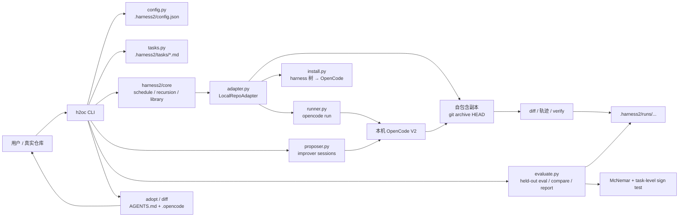
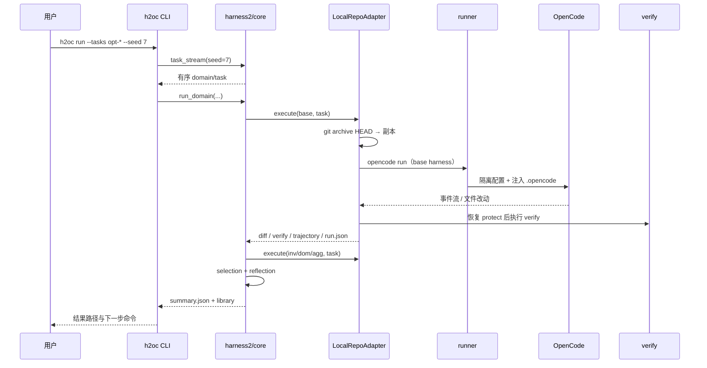

# h2oc 实现计划：原型、架构、原理与验收

> 本文回答四个问题：项目要做什么、原型长什么样、代码如何分层、怎样判断它真的完成了。
> 快速上手看 [README](../README.md)，实验协议看 [evaluation.md](evaluation.md)，项目背景和
> 当前结论看 [overview.md](overview.md)。

状态：v0.1.0；M0–M6 已完成。真实仓库的 held-out A/B 仍需要用户提供仓库与任务后执行。

---

## 1. 项目目标

### 1.1 一句话

把 Google Research 的 Harness² 递归优化方法接到本机 OpenCode V2 上，在**真实仓库**里
优化「模型之外的系统」，并用**可复现的证据链**判断优化是否真的有效。

### 1.2 要交付的能力

| 能力 | 具体表现 |
|---|---|
| 本地执行 | 用已登录的 `opencode run` 跑 rollout，不依赖 GCP、Linux 容器或官方 benchmark |
| 递归优化 | 复用上游 Propose–Probe–Compose、selection、library，产出可评审的 harness 树 |
| 安全探针 | 每次 rollout 在 `git archive HEAD` 的自包含副本里运行，主仓库不被污染 |
| 落盘 | 胜出组件写入项目 `AGENTS.md` + `.opencode/`，或全局 OpenCode 配置 |
| 评估 | held-out 任务、重复运行、`protect`、McNemar / task-level sign test、Markdown 报告 |
| 可复现 | 记录 harness 指纹、commit、模型、任务签名、轨迹、diff、verify 输出 |

### 1.3 非目标

- 复现官方 JobBench / LAB / WorkBuddy-Bench 分数；
- 训练模型或修改模型权重；
- 做通用 agent 框架；
- 把「一次 verify 通过」当成「harness 更好」；
- 提供强安全沙箱。`permission.external_directory` 只是文件工具围栏，shell 仍可越界。

### 1.4 成功标准

| 级别 | 判据 | 当前 |
|---|---|---|
| L1 可用 | 真实仓库跑完一轮，产出 diff / verify / 轨迹 / summary | 已达成（demo） |
| L2 可信 | 正确性可独立验证：`protect` + 确定性 `verify` + run 签名 | 已具备 |
| L3 可证 | held-out A/B + 配对统计证明改进，回归集不退化 | 工具就绪，待真实数据 |
| L4 可复用 | 同 domain 多任务共享 library，收益随任务累积 | 机制已接，待验证 |

---

## 2. 原型图

### 2.1 系统原型（组件与数据流）



核心边界：

- `harness2/core/*` **不修改**，负责调度、递归、选择、library、树结构；
- `h2oc` 只实现三个替换点：本地 adapter、本地 proposer、OpenCode V2 落盘；
- `evaluate.py` 是独立评估层，不参与优化，避免「用训练集证明自己」。

### 2.2 一次 `h2oc run` 的时序



### 2.3 探针隔离

```text
主仓库 HEAD
   │  git archive HEAD
   ▼
$TMPDIR/h2oc-wt-*/repo       ← 自包含副本，git init + baseline commit
   │  写入 .opencode/harness + .opencode/opencode.json
   ▼
opencode run --standalone    ← XDG_CONFIG_HOME 私有，PWD 同步，auth 共享
   │
   ├─ diff.patch / trajectory.md / meta.json / run.json
   ├─ restore_protected(tests/, Makefile, ...)
   └─ verify 命令 → verify.txt
```

---

## 3. 架构

### 3.1 目录与模块

```text
.
├── pyproject.toml                 # h2oc 包；harness2 是 editable path dependency
├── harness2/                      # Git submodule，固定上游 commit
├── h2oc/
│   ├── cli.py                     # init/run/adopt/diff/eval/compare/report/status/doctor
│   ├── config.py                  # Settings、路径解析、.harness2 布局
│   ├── tasks.py                   # 任务 frontmatter、glob 选择
│   ├── adapter.py                 # BenchmarkAdapter：副本、diff、verify、轨迹、run 签名
│   ├── runner.py                  # opencode run、PWD/XDG/环境隔离、项目配置
│   ├── proposer.py                # 本机 OpenCode 的 improver session
│   ├── install.py                 # harness 树 → AGENTS.md / .opencode
│   ├── evaluate.py                # held-out eval、统计、Markdown 报告
│   └── templates/                 # 默认 base harness + /harness2 命令
├── examples/txtstat/              # 自带 demo（源码由父仓库跟踪；运行时用 setup_demo.sh 建 Git 基线）
├── scripts/
│   ├── setup_demo.sh              # 初始化 demo 的独立 Git 仓库
│   ├── verify_isolation.py        # 验证嵌套 OpenCode 不逃逸
│   ├── verify_proposer.py         # 验证 improver 编辑/交回
│   └── probe_once.py              # 单次探针调试
├── tests/test_h2oc.py             # 不调用模型的单元测试
└── docs/
    ├── plan.md                    # 本文
    ├── overview.md                # 项目总纲与当前结论
    └── evaluation.md              # held-out A/B 实验手册
```

### 3.2 模块职责与依赖方向

| 模块 | 输入 | 输出 | 不负责 |
|---|---|---|---|
| `cli` | 命令行、配置、任务 | 调度、终端输出、退出码 | 具体 rollout 细节 |
| `adapter` | 任务、harness 树、设置 | run 目录（diff/verify/轨迹/签名） | 递归策略 |
| `runner` | prompt、cwd、模型、config dir | stdout/stderr/returncode/墙钟 | harness 内容 |
| `proposer` | 上游 proposer 合同 | 改后的 harness 树 | 评估 |
| `install` | harness 树 | `AGENTS.md` / `.opencode` 布局 | 运行任务 |
| `evaluate` | 固定 harness、任务、重复数 | eval.json、配对统计、报告 | 优化 harness |
| `harness2/core` | adapter/proposer | 递归、选择、library | 本地执行细节 |

依赖方向是单向的：`cli → adapter/proposer/evaluate → runner/install → 外部 CLI`；
`harness2/core` 只通过协议调用 adapter/proposer，不反向依赖 h2oc 的评估层。

### 3.3 `.harness2` 运行时布局

```text
.harness2/
├── config.json                    # 模型、超时、verify、k、mode
├── base/                          # 基础 harness（8 类组件目录）
├── tasks/*.md                     # 任务与验收标准
├── context/<task>/                # 可选任务材料（复制到副本 .opencode/context）
├── runs/
│   └── local-oc-agg1[-s7]/<task>/
│       ├── summary.json
│       ├── harnesses/<label>/
│       └── ledger-*/...           # 上游 rollout 证据
├── library/k1/agg/<domain>/       # 跨任务经验
├── adopted/<task>/                # adopt 快照
├── evals/<name>/                  # eval.json + runs/
└── _audit/                        # proposer 审计
```

`run` 的目录名由上游 `Namespace("local", "oc", mode, k, seed)` 生成；`--seed` 同时改变
任务顺序和目录名。`status/diff/adopt` 接受同一个 `--seed` 来定位。

---

## 4. 实现原理

### 4.1 为什么复用上游 core

Harness² 的价值在递归方法，而不是 benchmark 容器。复用 `schedule`、`recursion`、
`selection`、`library`、`tree` 能保证：

- `k=1` / `k≥2` 的预算和候选池与论文一致；
- library 的跨任务累积、experience 的写入格式不走样；
- 上游修复递归 bug 时，h2oc 自动受益。

代价是锁定上游 schema。当前固定 commit `1cfe254`（0.1.0），适配层集中在
`adapter.py`、`proposer.py`、`install.py`，升级时只需审查这三处。

### 4.2 为什么用自包含副本而不是 `git worktree`

linked worktree 与主仓库共享 `.git` 元数据，OpenCode 可能把项目解析回主 checkout，
导致 agent 在主仓库改文件、diff 为空、候选互相污染。`git archive HEAD` + `git init` 得到
完全独立的副本，代价是未提交改动和 gitignore 的依赖不会进入副本。

### 4.3 为什么 `protect` 在 diff 之后执行

顺序必须是：

1. 采集 agent 改动（`diff.patch`）——证据保留 agent 是否改了测试；
2. 恢复 `protect` 路径到 HEAD；
3. 执行 `verify`——验证器看到原始测试。

如果先恢复再采集，就看不出 agent 是否试图改测试；如果只恢复不采集，就无法审计。

### 4.4 为什么评估要配对、重复、held-out

单次 rollout 的方差极大：同一任务、同样可编辑组件的两次运行可能是 68.9s vs 27.8s。
因此：

- **held-out**：优化集只用于改 harness，最终对比必须用没参与优化的任务；
- **重复**：每个任务跑 3–5 次，降低 provider 波动；
- **配对**：按 `(task, repeat)` 对齐 A/B，用 McNemar exact 检验；
- **task-level sign test**：同一任务的重复不独立，按任务聚合更保守；
- **回归集**：base 已通过的任务不能退化；
- **人工盲评**：自动 verify 覆盖不了可维护性、范围蔓延和写死答案。

### 4.5 为什么 eval 需要 run 签名

只看 `meta.json` 是否存在会把旧配置的 rollout 当成新配置的证据。现在的签名包含：

```text
task_id + task 文件内容哈希 + harness 指纹 + model + repo commit + verify/protect
```

签名不一致的 run 会被移到 `*.stale-<时间>` 并重跑，旧证据保留。`compare` 还会检查
A/B 的任务集、重复数、模型、commit 和 harness 指纹是否一致。

### 4.6 为什么 `k=1` 不能证明比 base 好

`k=1` 只有一个 final，上游选择器被跳过；`k≥2` 的选择器也只比较 `k` 个 final，
`base` 是共享参考、不在候选池。`h2oc run` 的职责是产生候选，证明候选优于 base 必须
另外做 held-out A/B。

---

## 5. 实现方案与里程碑

### 5.1 已完成（M0–M6）

| 里程碑 | 目标 | 交付物 | 验收 |
|---|---|---|---|
| **M0 调研** | 确认上游可复用范围与本机可行性 | 源码分析、环境盘点 | 官方 benchmark 不可行 → 决定本地适配 |
| **M1 执行层** | 隔离副本里跑本机 OpenCode | `adapter.py`、`runner.py` | `scripts/verify_isolation.py` PASS；PWD 逃逸修复 |
| **M2 递归闭环** | Propose–Probe–Compose 完整跑通 | `proposer.py`、`cli.run` | 一次 k=1 全绿，产出 summary/library |
| **M3 落盘** | 胜出 harness 写进 V2 原生布局 | `install.py`、`adopt`、`diff` | 托管块、备份、无改动不安装 |
| **M4 评估体系** | 证明「更好」而非「跑通」 | `evaluate.py`、`eval`、`compare`、`protect` | 单元测试 + demo 冒烟 + 统计输出 |
| **M5 文档** | 让别人能复现 | README、overview、evaluation | 命令与实现逐条核对 |
| **M6 加固** | 修掉已知设计缺口 | seed 收口、run 签名、`--require-verify`、submodule、demo setup、`report` | 19 个单元测试；dry-run/doctor/status 通过 |

M6 的具体改动：

1. `--seed` 同时进入命名空间、`schedule.task_stream` 任务顺序和 `status/diff/adopt`；
2. `eval` 复用前校验 task/harness/model/commit 签名，不匹配则隔离并重跑；
3. `run` 对缺 verify 的任务默认警告，`--require-verify` 时失败；
4. `harness2/` 改为指向 `google-research/harness2` 的 Git submodule，固定 `1cfe254`；
5. demo 源码由父仓库跟踪，`setup_demo.sh` 建立独立 Git 基线，避免 gitlink/子模块错配；
6. `h2oc report` 输出可分享的 Markdown 对照报告；
7. `run --max-tasks` 提供轻量预算护栏。

### 5.2 当前仓库的 Git 管理

```sh
# 父仓库
git@github.com:davidtan2008/google-harness2.git

# 子模块
harness2 -> https://github.com/google-research/harness2.git
            pinned 1cfe254e8d25b15f37048c3730134686abe60335

# demo
examples/txtstat/  源码在父仓库；.git 由 scripts/setup_demo.sh 创建，不提交
```

为什么 demo 不做成 submodule：它没有独立远端，且需要随时修改任务和 baseline。把源码作为
普通文件跟踪，再在本地建立一次性 Git 基线，比一个无法 `submodule update` 的 gitlink 更
可复现。父仓库 `.gitignore` 明确忽略 `examples/txtstat/.git/`。

### 5.3 后续路线图

| 优先级 | 事项 | 验收 | 状态 |
|---|---|---|---|
| P0 | 接入真实仓库：3–8 opt + 8–20 heldout + 3–10 reg | 基线 30%–70%；候选 held-out 提升且回归不退化 | 待外部输入 |
| P1.1 | 真实 k=2 端到端 | selection 非 trivial，summary 有选择理由 | 待运行 |
| P1.2 | library 跨任务复用 | 第二个任务提案引用第一个任务的经验 | 待运行 |
| P1.3 | 预算/随机化收口 | seed 可复现；成本护栏 | seed/`--max-tasks` 已完成，成本预算待做 |
| P1.4 | 任务生成辅助 | 从 git 历史/issue 生成候选任务，人工筛 | 待做 |
| P2.1 | 多信号评分 | lint/类型/覆盖率/diff 规模进入报告 | 待做 |
| P2.2 | 盲评流程 | 去标签 diff 评审与自动指标对照 | 待做 |
| P2.3 | 统计增强 | bootstrap / 分层模型 | 待做 |
| P2.4 | 分享报告 | Markdown/JSON 报告 | **已完成**（`h2oc report`） |
| P3.1 | plugin 组件验证 | 最小 plugin 在 V2 触发 hook | 待做 |
| P3.2 | A/B/n 与 CI | 定时重跑 held-out，监控漂移 | 待做 |

---

## 6. 完整实现计划（可执行清单）

### 6.1 环境与依赖

- [x] Python 3.12 / 3.13；
- [x] `uv` 创建虚拟环境，`uv pip install -e .`；
- [x] `harness2` 以 editable path dependency 安装；
- [x] `opencode --version` 可用且已登录；
- [x] `git` 可用；
- [x] `h2oc doctor` 全部通过。

### 6.2 仓库与子模块

- [x] 父仓库恢复为 h2oc 项目，不再包含上游根目录副本；
- [x] `harness2/` 指向 Google 官方仓库，固定 `1cfe254`；
- [x] `.gitmodules` 可被 `git submodule update --init` 使用；
- [x] demo 不再以无 `.gitmodules` 的 gitlink 形式提交；
- [x] `.gitignore` 覆盖虚拟环境、缓存、egg-info、demo 运行产物和 demo `.git`。

### 6.3 核心功能

- [x] `init`：base harness、任务目录、OpenCode 组件；
- [x] `run`：k=1/k≥2、parallel/sequential、seed、max-tasks、require-verify；
- [x] `adopt` / `diff`：托管块、备份、无改动守卫、seed 定位；
- [x] `eval`：held-out、重复、并发、protect、run 签名复用；
- [x] `compare`：配对 McNemar、task-level sign test、一致性警告；
- [x] `report`：Markdown 报告；
- [x] `status` / `doctor`：任务、runs、evals、环境自检；
- [x] 探针隔离：副本、私有 XDG、PWD、文件工具围栏；
- [x] 轨迹与证据：`events.jsonl`、`trajectory.md`、`diff.patch`、`verify.txt`、`meta.json`、`run.json`。

### 6.4 测试与验收命令

```sh
source .venv/bin/activate
uv pip install -e .
python -m unittest discover -s tests -q
h2oc doctor --path examples/txtstat
./scripts/setup_demo.sh
h2oc status --path examples/txtstat
h2oc run --path examples/txtstat --dry-run --seed 7 --require-verify
h2oc eval --path examples/txtstat --dry-run --harness base --repeats 2

# 真实运行（会产生模型调用）
cd examples/txtstat
h2oc run --tasks fix-summarize --k 1 --require-verify
h2oc diff --task fix-summarize
h2oc adopt --task fix-summarize
```

### 6.5 完成定义（Definition of Done）

一个交付项只有同时满足以下条件才算完成：

1. 代码路径有单元测试或可重复的 dry-run；
2. CLI 的 `--help` 和 README/plan 中的命令一致；
3. 失败时给出可操作的错误，而不是静默复用或半途退出；
4. 证据写入磁盘，且能被 `status` / `compare` / `report` 读取；
5. 不修改 `harness2/` 上游源码；
6. 不把运行时产物、缓存或嵌套 `.git` 提交进父仓库。

### 6.6 已知风险

| 风险 | 影响 | 应对 |
|---|---|---|
| 免费模型波动 | 单次通过/耗时不可当结论 | 3–5 repeats，看 task-level sign test |
| `k=2` 未跑真实数据 | 选择器路径未验证 | P1.1 小样本试跑 |
| 探针不是沙箱 | shell 可越界、可联网 | 不可信仓库放进容器/虚拟机 |
| plugin API 未验证 | adopt 后可能不触发 | base 不含 plugin；adopt 前人工审查 |
| 全局 scope 未实测 | 写入 `~/.config/opencode` 有风险 | 先 `--scope project`，备份后再全局 |
| 上游 schema 变化 | 适配层可能失效 | 锁 commit，升级时只审查 adapter/proposer/install |
| 从 HEAD 复制 | 未提交依赖/大文件缺失 | 把安装步骤写进 verify，或改用容器 |

---

## 7. 如何验证 Harness² 是否真的改进了 OpenCode

最短可信流程（完整版见 [evaluation.md](evaluation.md)）：

1. **准备任务**：`opt-*`（优化，3–8 个）、`heldout-*`（留出，8–20 个）、`reg-*`（回归，
   3–10 个）；每条都有确定性 `verify`，baseline 失败、参考解通过。
2. **跑基线**：`h2oc eval --tasks 'heldout-*' --harness base --repeats 3 --protect tests/`。
3. **优化**：`h2oc run --tasks 'opt-*' --k 2 --protect tests/`，人工审查 `h2oc diff`，
   确认没有写死答案或任务特定知识。
4. **跑候选**：`h2oc eval --tasks 'heldout-*' --harness adopted:<task> --repeats 3`。
5. **配对比较**：`h2oc compare`，优先看 task-level sign test；`p < 0.05` 才叫统计证据。
6. **回归与成本**：`reg-*` 不退化；比较 wall time、steps、tool calls、tokens。
7. **盲评**：去标签看 diff，检查可维护性、范围蔓延、是否改测试。
8. **报告**：`h2oc report --a base --b cand --out reports/ab.md` 存档。

结论可以是「没有改进」。如果候选 harness 与 base 相同，`adopt` 不会写入任何文件；
这应被视为优化器的正确判断，而不是失败。
